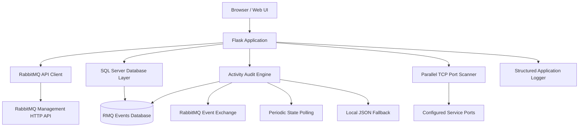

# RabbitMQ Web Toolkit — RMQ QA Utility

A browser-based RabbitMQ administration and QA toolkit built with **Python, Flask, and RabbitMQ's Management HTTP API**. It combines broker monitoring, queue operations, message backup and restore utilities, TCP port scanning, and SQL Server-backed activity auditing in a single web interface.

Designed for RabbitMQ administrators, application support engineers, QA teams, and infrastructure engineers who need practical operational visibility and diagnostic tools.

<p align="center">

**Broker Management · Queue Operations · Activity Auditing · Connectivity Diagnostics**

</p>

---

## Table of Contents

- [Overview](#overview)
- [Key Features](#key-features)
- [Architecture](#architecture)
- [Technology Stack](#technology-stack)
- [Requirements](#requirements)
- [Installation](#installation)
- [Configuration](#configuration)
- [Database Setup](#database-setup)
- [Running the Application](#running-the-application)
- [Using the Web Interface](#using-the-web-interface)
- [Queue Message Operations](#queue-message-operations)
- [Activity Auditing](#activity-auditing)
- [Port Scanner](#port-scanner)
- [HTTP API Reference](#http-api-reference)
- [Project Structure](#project-structure)
- [Logging and Troubleshooting](#logging-and-troubleshooting)
- [Security Considerations](#security-considerations)
- [Known Limitations](#known-limitations)
- [Future Enhancements](#future-enhancements)
- [Contributing](#contributing)
- [License](#license)

---

## Overview

RabbitMQ Web Toolkit provides a centralized web interface for inspecting and administering a RabbitMQ broker through its Management HTTP API.

Instead of switching between command-line utilities, management screens, database queries, and log files, support engineers can use a single application for common broker administration and QA activities.

The toolkit combines two primary capabilities:

1. **RabbitMQ administration:** Monitor broker health, inspect queues and consumers, manage exchanges and virtual hosts, review connections, and perform supported resource-management operations.
2. **QA and diagnostics:** Track broker changes, inspect TCP port availability, export audit records, back up queue messages, and investigate connectivity or operational issues.

### Design Principles

- **Centralized operations:** Access commonly used RabbitMQ management functions from one interface.
- **Operational visibility:** Review broker status, queue statistics, message rates, and node information.
- **Traceability:** Record supported administrative activities and detected broker changes.
- **Database-backed auditing:** Store audit records in SQL Server when the database is available.
- **Resilient audit storage:** Use a local JSON fallback when database initialization or writes are unavailable.
- **Configuration-driven deployment:** Manage application settings through `config.json`.
- **Windows-friendly execution:** Start the application using Python or the supplied Windows batch launcher.

> **Important:** This is an independent administration utility built on RabbitMQ's Management HTTP API. It is not an official RabbitMQ product or a replacement for the native RabbitMQ Management UI.

## Key Features

### 1. Broker Monitoring and Overview

- View broker and cluster information.
- Review available nodes and node status.
- Monitor queue, exchange, connection, and other resource totals.
- Inspect message rates and top queues.
- Review memory utilization and file-descriptor usage where the broker exposes the required metrics.
- Check application, broker, and database connectivity status.

### 2. Queue Management

- List and search queues.
- Create queues.
- Purge queue messages.
- Delete individual queues.
- Select multiple queues for bulk purge or deletion.
- Preview queue messages.
- Publish messages through the supported API.
- Back up messages from individual or multiple queues.
- Restore supported JSON message formats.
- Track the progress of asynchronous multi-queue backup operations.

**Use caution:** Purge and delete operations can permanently remove messages or queue resources. Always validate the target vhost and queue before executing destructive actions.

### 3. Connections and Channels

- List active RabbitMQ connections.
- Close individual connections.
- Inspect channels.
- Review consumer counts and prefetch settings.
- Inspect unacknowledged message counts.

These capabilities help investigate stuck consumers, connection problems, and message-processing delays.

### 4. Exchanges and Bindings

- List exchanges.
- Create exchanges.
- Delete supported non-system exchanges.
- Inspect bindings.
- Create bindings through the backend API.

Exchange deletion and binding changes can affect message routing and should be performed only after validating dependencies.

### 5. Users, Permissions, and Virtual Hosts

- List RabbitMQ users.
- Create and delete users.
- Assign full permissions on a selected vhost through the supported user-creation workflow.
- Inspect permissions and user information.
- List, create, and delete virtual hosts.

The current interface does not provide a complete user-permission editing workflow or every possible resource-update operation.

### 6. Policies and Shovels

- List, create, and delete supported policies.
- List and create dynamic shovels.
- Inspect available broker configuration through the supported endpoints.

Updating existing policies and shovels is not currently available as a complete CRUD workflow.

### 7. Connectivity Diagnostics

- Scan configured RabbitMQ-related TCP ports.
- Execute parallel connection checks.
- Display port status and response latency.
- Trigger manual scans.
- Run scheduled background rescans.
- Configure scan intervals and connection timeouts.

The port scanner checks TCP connectivity only. An open port does not guarantee successful authentication, TLS negotiation, protocol compatibility, or application-level connectivity.

### 8. Activity Auditing

- Detect supported broker resource changes.
- Monitor RabbitMQ events through the event exchange when available.
- Compare broker snapshots through periodic polling.
- Store audit entries in SQL Server when available.
- Fall back to a local JSON file when database storage is unavailable.
- Search and filter audit records.
- Paginate audit results.
- Export audit records to CSV.
- Purge records older than a selected retention period.

The application supports both event-based monitoring and state-difference polling. Their behavior and limitations are described in the [Activity Auditing](#activity-auditing) section.

---

## Architecture

The application follows a Flask-based backend architecture with a browser UI, a RabbitMQ Management API client, a SQL Server persistence layer, and supporting monitoring utilities.



### Request and Monitoring Flow

1. The user accesses the browser-based interface.
2. Flask handles UI requests and API operations.
3. The RabbitMQ client communicates with the configured broker.
4. The audit engine monitors supported broker events and resource changes.
5. Audit records are written to SQL Server when available, with JSON fallback for audit entries.
6. The port scanner checks configured TCP endpoints independently of RabbitMQ API operations.
7. Application logs capture diagnostic and operational information.

The diagram represents the logical architecture; individual monitoring and persistence functions remain subject to the implementation limitations documented below.

## Technology Stack

| Component | Technology |
|---|---|
| Backend | Python 3.10+ |
| Web framework | Flask |
| Broker integration | RabbitMQ Management HTTP API |
| HTTP client | Requests |
| Database | Microsoft SQL Server |
| Database connectivity | pyodbc |
| Database driver | Microsoft ODBC Driver 17 or configured equivalent |
| Frontend | HTML, CSS, JavaScript |
| Diagnostics | Python socket-based TCP scanning |
| Logging | Rotating file and console logging |
| Audit fallback | Local JSON file |
| Export formats | CSV and JSON; ZIP for supported multi-queue backups |
| Primary platform | Windows-compatible, Python-based execution |

---

## Requirements

Before installing the toolkit, ensure the following components are available.

| Requirement | Details |
|---|---|
| Python | Version 3.10 or newer |
| RabbitMQ | A reachable broker with the Management Plugin enabled |
| RabbitMQ account | Permissions appropriate to the operations you intend to perform |
| SQL Server | Required for database-backed auditing; optional if using fallback storage |
| ODBC driver | Microsoft ODBC Driver 17 for SQL Server or the configured installed driver |
| Network access | Access to the RabbitMQ Management API and SQL Server, where applicable |
| Operating system | Windows is supported by the supplied batch launcher |

Useful references:

- [Python downloads](https://www.python.org/downloads/)
- [RabbitMQ Management Plugin](https://www.rabbitmq.com/docs/management)
- [Microsoft ODBC Driver for SQL Server](https://aka.ms/downloadmsodbcsql)
- [Flask documentation](https://flask.palletsprojects.com/)
- [pyodbc documentation](https://github.com/mkleehammer/pyodbc)

---

## Installation

### Step 1 — Clone the repository

```powershell
git clone https://github.com/iamgstomar/RabbitMQ-Web-Toolkit.git
cd RabbitMQ-Web-Toolkit
```

If your GitHub repository uses a different URL, replace the clone URL accordingly.

### Step 2 — Create a virtual environment

```powershell
py -3.10 -m venv .venv
```

Activate the environment:

```powershell
.\.venv\Scripts\Activate.ps1
```

If PowerShell blocks activation, you can invoke the virtual environment's Python executable directly without activating it.

### Step 3 — Install dependencies

Upgrade pip and install the project dependencies:

```powershell
python -m pip install --upgrade pip
python -m pip install -r requirements.txt
```

The project's `requirements.txt` contains the required Python packages, including Flask, Requests, pyodbc, and urllib3.

### Step 4 — Install the SQL Server ODBC driver

Install the driver specified in `config.json`.

For example, if the configuration specifies `ODBC Driver 17 for SQL Server`, ensure that exact driver is installed and visible to Python.

Verify the available ODBC drivers:

```powershell
python -c "import pyodbc; print(pyodbc.drivers())"
```

If the configured driver is missing, install it or update the configuration to use a compatible driver that is already installed.

### Step 5 — Configure the application

Open `config.json` and update the RabbitMQ, SQL Server, and server settings for your environment.

Do not proceed with production credentials until you have reviewed the security recommendations in this README.

### Step 6 — Prepare SQL Server

If database-backed auditing is required, execute `setup_database.sql` in SQL Server Management Studio and verify that the application login has the required permissions.

See [Database Setup](#database-setup) for details.

---

## Configuration

All application settings are loaded from `config.json` at startup. Restart the application after changing configuration values.

### Example RabbitMQ Configuration

The following is an illustrative configuration for a broker using the HTTP Management API:

```json
{
  "rabbitmq": {
    "host": "rabbitmq.example.internal",
    "port": 15672,
    "username": "rmq-admin",
    "password": "replace-with-a-secret",
    "vhost": "/",
    "ssl": false,
    "verify_ssl": true,
    "timeout": 10,
    "schemes": ["http", "https"]
  }
}
```

This is a partial example, not a complete replacement for the project's configuration file. Preserve other required application settings.

### RabbitMQ Settings

| Setting | Purpose |
|---|---|
| `host` | RabbitMQ server hostname or IP address |
| `port` | Management API port |
| `username` | RabbitMQ account used by the application |
| `password` | RabbitMQ account password |
| `vhost` | Default vhost setting |
| `ssl` | SSL-related configuration flag |
| `verify_ssl` | Controls certificate verification where applied |
| `timeout` | HTTP request timeout in seconds |
| `schemes` | HTTP/HTTPS schemes considered by the client |

Common Management API ports are `15672` for HTTP and `15671` for HTTPS, although the actual ports depend on the broker configuration.

**Connection behavior:** The current Connect workflow uses the broker settings in `config.json`. The hostname field displayed in the UI is informational and does not override the configured broker target. To switch brokers, update the configuration and restart the application.

### Example SQL Server Configuration

```json
{
  "database": {
    "driver": "ODBC Driver 17 for SQL Server",
    "host": "sql.example.internal",
    "port": 1433,
    "name": "RMQ_Events",
    "username": "rmq_app",
    "password": "replace-with-a-secret",
    "trusted_connection": false,
    "encrypt": true,
    "trust_server_certificate": false,
    "auto_create_tables": true
  }
}
```

Merge these values into the existing `database` section rather than replacing the entire configuration file.

### SQL Server Settings

| Setting | Purpose |
|---|---|
| `driver` | Installed ODBC driver name |
| `host` | SQL Server hostname or address |
| `port` | SQL Server TCP port |
| `name` | Target database name |
| `username` | SQL authentication username |
| `password` | SQL authentication password |
| `trusted_connection` | Enables Windows Authentication when supported and set to `true` |
| `encrypt` | Controls connection encryption |
| `trust_server_certificate` | Controls certificate trust behavior |
| `schema` | Database schema, typically `dbo` |
| `table_audit` | Main audit table name |
| `table_events` | Raw event table name |
| `table_snapshots` | Snapshot table name |
| `auto_create_tables` | Allows configured tables to be created during database initialization |

For Windows Authentication, set `trusted_connection` to `true` and ensure the Windows account running the application has the necessary SQL Server permissions.

For production environments, prefer encrypted connections with proper certificate validation.

### Audit Configuration

The `audit` section controls monitoring behavior.

| Setting | Purpose |
|---|---|
| `event_exchange` | Enables the attempt to use RabbitMQ event-exchange monitoring |
| `poll_interval_seconds` | State-difference polling interval; default is 10 seconds |
| `plugin_poll_interval_seconds` | Event-queue polling interval; default is 3 seconds |
| `store_raw_event` | Enables raw event storage when the required mode and database are available |
| `retention_days` | Default age used by the manual audit-purge prompt |
| `max_detail_length` | Maximum audit detail text length |
| `dedup_cache_size` | Maximum number of recent event deduplication keys retained in memory |

The retention setting does not mean records are automatically deleted on a schedule. The current purge workflow is a manual UI operation.

### Port Scanner Configuration

The `ports` section contains settings for connectivity diagnostics.

| Setting | Purpose |
|---|---|
| `scan_on_connect` | Starts a scan when connecting to RabbitMQ |
| `rescan_interval_seconds` | Background rescan interval |
| `timeout_seconds` | TCP connection timeout for each port |
| `monitor` | Port-to-service mapping to probe |

The current configuration contains 12 monitored ports. The actual port list depends on your `config.json`.

### Logging Configuration

The `logging` section and `logger.py` control application logging.

| Setting | Purpose |
|---|---|
| `level` | Logging severity threshold |
| `file` | Log file location |
| `max_bytes` | Maximum size before log rotation |
| `backup_count` | Number of rotated files to retain |
| `console` | Enables console logging |
| `json_format` | Enables structured JSON formatting |
| `format` | Text log format |
| `date_format` | Timestamp format |

### Web Server Configuration

| Setting | Purpose |
|---|---|
| `host` | Network interface to bind |
| `port` | HTTP listening port |
| `debug` | Flask debug mode |
| `auto_open_browser` | Controls automatic browser opening |
| `secret_key` | Flask secret key |
| UI title/theme settings | Controls supported interface appearance options |

For local-only usage, set `server.host` to `127.0.0.1`. Binding to `0.0.0.0` exposes the listener on all network interfaces and requires appropriate network restrictions.

---

## Database Setup

The project includes `setup_database.sql` for SQL Server provisioning.

### Step 1 — Execute the setup script

1. Open SQL Server Management Studio.
2. Connect to the intended SQL Server instance.
3. Open `setup_database.sql`.
4. Review the database name and SQL permissions.
5. Execute the script.
6. Confirm that the required database and tables exist.

The supplied script creates the `RMQ_Events` database and the following tables if they do not already exist:

| Table | Purpose |
|---|---|
| `dbo.audit_log` | Application audit entries and detected broker changes |
| `dbo.rmq_events` | Raw RabbitMQ events when event monitoring and database storage are available |
| `dbo.rmq_snapshots` | Snapshot table created by the setup script; the active code does not currently persist snapshots to it |

### Step 2 — Verify the database name

The database configured in `config.json` must match the database you provisioned.

For example:

```json
{
  "database": {
    "name": "RMQ_Events"
  }
}
```

If you use a different database name, create that database separately or update the setup script and configuration consistently.

### Step 3 — Verify permissions

The SQL login or Windows identity used by the application must be able to:

- Connect to the target database.
- Read and write the required audit/event tables.
- Create tables if `auto_create_tables` is enabled and automatic table creation is needed.

Database connectivity is optional for running the web application, but database-backed audit persistence depends on successful initialization and writes.

---

## Running the Application

### Option 1 — Start with Python

From the project directory:

```powershell
python app.py
```

### Option 2 — Start using the Windows launcher

```powershell
.\start.bat
```

The batch launcher installs the configured Python requirements and starts the application. For repeated development sessions, using an activated virtual environment is recommended.

### Access the Web Interface

The browser URL depends on `server.host` and `server.port` in `config.json`.

For example, if the configured port is `8081` and the application is running locally:

**http://127.0.0.1:8081**

If you change the port, use the new configured value.

> The current batch launcher contains a hard-coded `8080` banner, which may not match the actual port configured for Flask. The configuration file is the source of truth for the listening port.

---

## Using the Web Interface

### 1. Connect to RabbitMQ

- Open the configured application URL.
- Select **Connect**.
- Wait for the connection result.
- Verify the reported broker version and connection status.

The application uses the broker credentials and target configured in `config.json`.

### 2. Inspect Broker Resources

Use the relevant navigation tabs to review queues, exchanges, connections, channels, users, vhosts, policies, and other supported resources.

Most resource screens provide manual refresh functionality. Overview, Queues, and Audit also refresh automatically at 30-second intervals while active.

### 3. Perform Administrative Operations

Use the available create, delete, purge, and connection-management controls.

The interface requests confirmation for supported destructive operations, but confirmation prompts are not a substitute for verifying the target resource and vhost.

### 4. Review Activity Logs

The Audit Log can be accessed independently of a successful RabbitMQ connection.

When database storage is available, audit records are retrieved from SQL Server. If database initialization or writes are unavailable, the application uses the local JSON audit fallback where supported.

---

## Queue Message Operations

The toolkit provides message preview, backup, bulk backup, and restore utilities.

### Message Preview

The queue preview retrieves up to 20 messages using RabbitMQ's `ack_requeue_true` mode.

This mode requeues retrieved messages rather than intentionally consuming them permanently. Nevertheless, previewing messages should be tested carefully in your environment, particularly when applications are actively consuming from the same queue.

### Single-Queue Backup

The single-queue backup operation requests up to 10,000 messages and generates a JSON download.

The current export contains message payloads rather than a complete RabbitMQ message envelope. Properties and routing metadata may therefore be omitted.

### Multi-Queue Backup

The multi-select backup endpoint:

- Executes asynchronously.
- Reports backup progress.
- Generates JSON for a single selected queue.
- Generates a ZIP archive for multiple selected queues.

The current chunk-collection implementation uses message signatures to identify repeated results. Distinct messages with identical signatures may be collapsed, so the output should not be assumed to be a lossless broker backup.

### Message Restore

The restore interface accepts JSON files or pasted JSON and allows the target queue to be selected or detected.

The restore path expects structured message entries containing a `payload` field, with optional `payload_encoding` and `properties`.

**Important compatibility limitations:**

- The single-queue backup format is not guaranteed to be directly compatible with the restore format.
- The multi-queue ZIP archive is not accepted by the visible restore modal.
- Message properties, routing information, delivery metadata, and other envelope fields may not be preserved.
- Queue backup should not be treated as a complete RabbitMQ disaster-recovery solution.

Always validate the exported format and test restoration using a non-production queue before relying on it.

---

## Activity Auditing

The audit engine supports two complementary monitoring approaches.

### 1. State-Difference Polling

After connecting, the audit engine takes an initial baseline and periodically compares supported RabbitMQ resource state.

The current implementation compares resources including:

- Queues.
- Exchanges.
- Users and tags.
- Virtual hosts.
- Policies.
- Bindings.

It can detect supported creation and deletion operations, selected user tag changes, and some queue-purge scenarios when a queue's message count drops to zero.

**Limitations:**

- Diff-only detection cannot reliably identify the user who performed a change.
- Actor attribution may be inferred from active or recently observed users.
- A purge cannot always be distinguished from other operations that reduce the message count to zero.
- Changes between polling intervals may not be reconstructed with complete historical detail.

### 2. RabbitMQ Event-Exchange Monitoring

When enabled and available, the audit engine attempts to create a temporary queue in the default vhost and bind it to `amq.rabbitmq.event`.

The engine polls this queue and uses event actor information when RabbitMQ supplies it.

This approach requires:

- An available RabbitMQ event exchange.
- Appropriate permissions to create, bind, read, and delete the temporary queue.
- Network connectivity to the broker.
- Compatible broker configuration and event availability.

The temporary queue is cleaned up during disconnect where possible.

When event mode is active, state-difference polling remains enabled for tracking broker state, but duplicate change entries from diff polling are suppressed.

### 3. Audit Noise Filtering

The current audit implementation intentionally excludes selected noisy events, including:

- Connection, channel, and consumer activity.
- Alarm-related noise.
- Application Connect/Disconnect events.

Actions performed through supported application API routes are also recorded directly when the audit engine is running.

This provides operational traceability for supported actions but does not guarantee that every possible change made directly through RabbitMQ, another management client, or an external automation system will be attributed correctly.

### 4. Audit Storage and Fallback

| Storage | Current behavior |
|---|---|
| SQL Server `audit_log` | Main audit entries and detected changes |
| SQL Server `rmq_events` | Raw event records when event mode and database storage are available |
| SQL Server `rmq_snapshots` | Table is created, but the active application does not currently persist snapshots |
| `rmq_audit_log.json` | Local fallback for audit entries when database initialization or writes are unavailable |

The Audit Log supports search, filtering by user/action/source/date, pagination, CSV export, and manual purge by age.

Current implementation notes:

- CSV export does not apply the selected source filter.
- The UI exposes audit-column sort controls, but the backend currently ignores those sort parameters.
- The returned audit ordering therefore remains timestamp-based.
- CSV archival is not currently performed by the purge implementation, despite the presence of related configuration settings.

---

## Port Scanner

The built-in scanner performs parallel TCP connection checks against the ports defined in `config.json`.

It can be used to investigate network-level accessibility for RabbitMQ-related services.

### What It Checks

- Whether a TCP connection can be established.
- Whether the connection attempt succeeds within the configured timeout.
- The observed connection latency.
- Results from configured background or manually triggered scans.

### What It Does Not Check

A successful TCP connection does not verify:

- RabbitMQ authentication.
- Vhost permissions.
- TLS certificate trust.
- Application protocol compatibility.
- Message publishing or consumption.
- End-to-end application functionality.

If a port appears closed, check the target hostname, service listener, firewall rules, routing, and configured timeout.

---

## HTTP API Reference

The Flask application exposes backend routes under `/api`.

The following is a functional overview of the currently implemented endpoint groups. Individual methods, request bodies, response schemas, and error codes should be verified in `app.py` before integrating external clients.

| Endpoint | Purpose |
|---|---|
| `POST /api/connect` | Connect to the configured broker |
| `POST /api/disconnect` | Disconnect the application from RabbitMQ |
| `GET /api/status` | Read application, broker, and database status |
| `GET /api/overview` | Retrieve broker overview information |
| `GET /api/nodes` | Retrieve node information |
| `/api/queues` | List or create queues |
| `/api/queues/delete` | Delete a queue |
| `/api/queues/purge` | Purge queue messages |
| `/api/queues/messages` | Retrieve queue message previews |
| `/api/queues/publish` | Publish a message |
| `/api/queues/bulk-delete` | Delete multiple queues |
| `/api/queues/bulk-purge` | Purge multiple queues |
| `/api/queues/backup` | Back up messages from one queue |
| `/api/queues/backup-multiple` | Start a multi-queue backup |
| `/api/queues/backup-download` | Download generated backup output |
| `/api/queues/restore` | Restore messages using the supported request format |
| `/api/queues/restore-from-data` | Restore messages from supplied data |
| `/api/queues/backup-progress` | Retrieve asynchronous backup progress |
| `/api/exchanges` | List or create exchanges |
| `/api/bindings` | List or create bindings |
| `/api/connections` | Inspect connections |
| `/api/channels` | Inspect channels |
| `/api/users` | Inspect, create, or delete users |
| `/api/permissions` | Inspect permissions |
| `/api/whoami` | Retrieve supported identity information |
| `/api/vhosts` | List, create, or delete virtual hosts |
| `/api/policies` | List, create, or delete policies |
| `/api/shovels` | List or create supported shovels |
| `/api/definitions` | Read or import broker definitions |
| `/api/definitions/export` | Export broker definitions |
| `/api/feature-flags` | Inspect broker feature flags |
| `/api/aliveness` | Run a vhost aliveness check |
| `/api/ports` | Retrieve cached port-scan results |
| `/api/ports/scan` | Trigger a port scan |
| `/api/audit` | Retrieve audit records |
| `/api/audit/filters` | Retrieve supported audit filters |
| `/api/audit/export` | Export audit records |
| `/api/audit/purge` | Purge eligible audit records |
| `GET /api/config` | Retrieve a configuration subset with sensitive values omitted |

### API Notes

- Resource-management routes generally require a successful RabbitMQ connection.
- Status, configuration, audit, and port-scanner routes can be available independently of a broker connection, depending on their implementation.
- Not every endpoint provides complete CRUD functionality.
- Authentication and authorization for the Flask application itself are not implemented in the current version.
- The exact HTTP method, request schema, and response format should be checked in the route implementation before scripting against an endpoint.

---

## Project Structure

```text
RabbitMQ-Web-Toolkit/
│
├── app.py                  # Flask server, routes, and orchestration
├── rmq_client.py           # RabbitMQ Management HTTP API wrapper
├── db.py                   # SQL Server connectivity and persistence
├── audit.py                # Event monitoring and state-difference auditing
├── logger.py               # Structured and rotating application logging
├── port_scanner.py         # Parallel TCP port scanning
├── config.json             # Runtime configuration
├── requirements.txt        # Python dependencies
├── start.bat               # Windows launcher
├── setup_database.sql      # SQL Server database/table provisioning
│
├── templates/
│   └── index.html          # Single-page browser interface
│
├── static/
│                           # Static assets, where used
│
├── logs/
│                           # Application log output
│
└── archives/
                            # Reserved/configured archive location
```

### Core Modules

| File | Responsibility |
|---|---|
| `app.py` | Flask routes, connection lifecycle, API coordination, and backup/restore jobs |
| `rmq_client.py` | HTTP communication with RabbitMQ's Management API |
| `db.py` | SQL Server connectivity, table initialization, and audit/event persistence |
| `audit.py` | State-difference polling, event-exchange monitoring, and audit processing |
| `logger.py` | Console/file logging, rotation, and optional JSON formatting |
| `port_scanner.py` | Parallel TCP port checks and scheduled rescans |
| `config.json` | Broker, database, audit, scanner, logging, and server settings |
| `setup_database.sql` | Database and table creation |
| `templates/index.html` | Browser UI and frontend API calls |
| `start.bat` | Windows startup convenience script |

**Note:** `archives/` is part of the documented directory layout, but the active purge implementation does not currently archive expired audit records to CSV. The directory should not be interpreted as proof that automated archiving is implemented.

---

## Logging and Troubleshooting

The application uses `logger.py` to write console and rotating file logs.

The configured log path is controlled by `logging.file`; the typical default is:

```text
logs/rmq_qa.log
```

### Common Issues

| Symptom | Troubleshooting |
|---|---|
| RabbitMQ connection fails | Verify the Management Plugin, broker hostname, port, credentials, network connectivity, and account permissions |
| TCP port is open but connection fails | Check HTTP/HTTPS scheme selection, TLS configuration, certificate validation, and authentication |
| SQL Server status is unavailable | Verify the ODBC driver, server address, database name, authentication, encryption, and permissions |
| Audit records use JSON fallback | Check SQL Server connectivity, database initialization, table permissions, and database write errors |
| RabbitMQ events are missing | Confirm event-exchange availability, permissions, and temporary queue creation/binding |
| Audit actor is unknown | Diff-only polling cannot always establish the identity responsible for a change |
| Port scanner reports a closed port | Check service listeners, firewalls, network routes, and timeout settings |
| Browser opens the wrong URL | Verify `server.host` and `server.port` in `config.json` |
| Backup does not contain all expected messages | Review the backup limits, chunk handling, and identical-message signature limitation |
| Restore rejects a backup | Verify the JSON structure and required `payload` field; test with a compatible sample |
| Resource-management request fails | Check broker connectivity, vhost permissions, resource state, and the application log |

### Diagnostic Checklist

When investigating a connection or operational issue:

1. Confirm the application is running and listening on the configured address.
2. Verify the target broker and Management API port.
3. Check network connectivity from the application host.
4. Validate the broker account and vhost permissions.
5. Review the application log for HTTP, TLS, database, or parsing errors.
6. Confirm SQL Server connectivity if database-backed auditing is required.
7. Reproduce the issue against a non-production environment when destructive operations are involved.

---

## Security Considerations

The current application does **not** implement its own user login or authorization layer.

Anyone who can reach the Flask application may be able to invoke its API routes using the RabbitMQ credentials configured on the server. Treat access to the application as privileged administrative access.

### Before Deployment

- **Protect credentials:** Do not commit real RabbitMQ, SQL Server, or Flask secret values to GitHub.
- **Use least privilege:** Create a dedicated RabbitMQ account with only the permissions required for the intended operations.
- **Restrict network access:** Bind to `127.0.0.1` for local use or use suitable network controls for remote access.
- **Use authenticated HTTPS access:** If remote users require access, place the application behind an appropriately configured authenticated, TLS-protected reverse proxy or implement application authentication and authorization.
- **Disable debug mode:** Set `server.debug` to `false` outside development.
- **Replace default secrets:** Configure a strong, unpredictable Flask `secret_key`.
- **Validate TLS certificates:** Keep certificate verification enabled wherever applicable and use trusted certificates.
- **Protect SQL Server:** Use encrypted database connections and appropriate certificate validation.
- **Review destructive actions:** Test queue purge, queue deletion, connection closure, vhost deletion, and other administrative operations before production use.
- **Protect audit records:** Restrict access to the database and local JSON files because they may contain operational or user-related information.
- **Rotate exposed credentials:** If credentials have already been committed or shared, rotate them and remove them from the active configuration.

### GitHub Repository Hygiene

Before publishing the project, verify that `.gitignore` excludes local secrets, runtime logs, generated audit files, and environment-specific configuration.

An illustrative `.gitignore` is:

```gitignore
# Python
__pycache__/
*.py[cod]
.venv/
venv/

# Environment and secrets
.env
.env.*
!.env.example

# Runtime logs and local audit data
logs/
archives/
rmq_audit_log.json

# Local configuration containing credentials
config.local.json

# Editor and operating system files
.vscode/
.idea/
.DS_Store
Thumbs.db
```

**Important:** This example assumes you provide a separate safe configuration template and that `config.json` contains environment-specific credentials. If your current `config.json` is tracked, do not simply ignore it and assume GitHub history is clean. Remove sensitive values from the published configuration, review repository history, and rotate any credentials that were exposed.

---

## Known Limitations

The following limitations reflect the current implementation and should be considered when using the toolkit.

| Area | Limitation |
|---|---|
| Application access | No built-in user authentication or authorization |
| Broker selection | The Connect workflow uses the configured broker target; the UI hostname field does not override it |
| Resource administration | Not every resource supports full create, read, update, and delete operations |
| Queue backup | Export is not a complete broker-level or message-envelope backup |
| Queue restore | Single-queue export and restore formats are not guaranteed to be compatible |
| Multi-queue backup | Signature-based deduplication can collapse distinct messages with identical signatures |
| Multi-queue restore | ZIP backup files are not accepted by the visible restore modal |
| Audit actor attribution | Diff-only polling cannot reliably identify the actor for every change |
| Audit snapshots | The snapshot table exists, but the active application does not persist snapshots to it |
| Audit archival | The current purge implementation deletes eligible rows rather than archiving them to CSV |
| Audit export filters | The selected source filter is not applied to CSV export |
| Audit sorting | UI sort parameters are ignored by the current backend |
| Port scanning | Checks TCP reachability, not complete protocol or application health |
| Startup banner | The batch launcher's displayed port may differ from `config.json` |

These limitations should be reviewed before using the toolkit for production administration, compliance reporting, or disaster recovery.

---

## Future Enhancements

Potential improvements for future releases include:

- Application authentication, role-based access control, and session management.
- Secure externalized secrets and environment-specific configuration.
- Full resource update workflows for supported RabbitMQ entities.
- Improved queue backup with complete message properties and metadata preservation.
- Versioned, validated backup formats with reliable restore compatibility.
- Backup integrity verification and safer large-queue processing.
- Scheduled audit retention and CSV archival.
- Consistent audit filtering, sorting, and export behavior.
- Persistent broker snapshots and historical comparison.
- Improved event attribution and audit correlation.
- TLS and protocol-level diagnostics in addition to TCP scanning.
- Automated API and integration tests.
- Containerized deployment and documented reverse-proxy configuration.
- CI/CD checks for linting, testing, dependency security, and release packaging.

These are proposed enhancements, not claims about functionality already available in the current version.

---

## Contributing

Contributions, bug reports, documentation improvements, and feature suggestions are welcome.

A useful contribution workflow is:

1. Create a feature branch.
2. Make a focused change.
3. Test the change against a development or non-production RabbitMQ environment.
4. Verify error handling and destructive-operation safeguards.
5. Update documentation when behavior or configuration changes.
6. Submit a pull request with a clear description of the change and its validation.

Please do not include production credentials, customer information, or sensitive audit records in issues, commits, or pull requests.

---

## License

Choose and add an appropriate open-source license before distributing the repository publicly.

Until a license is explicitly added, do not assume that the project is licensed for unrestricted reuse, modification, or redistribution.

---

## Author

**Gajendra Tomar**

GitHub: [@iamgstomar](https://github.com/iamgstomar)

Explore more projects and development work on GitHub.

---

*RabbitMQ Web Toolkit — practical administration, monitoring, and QA diagnostics for RabbitMQ environments.*


